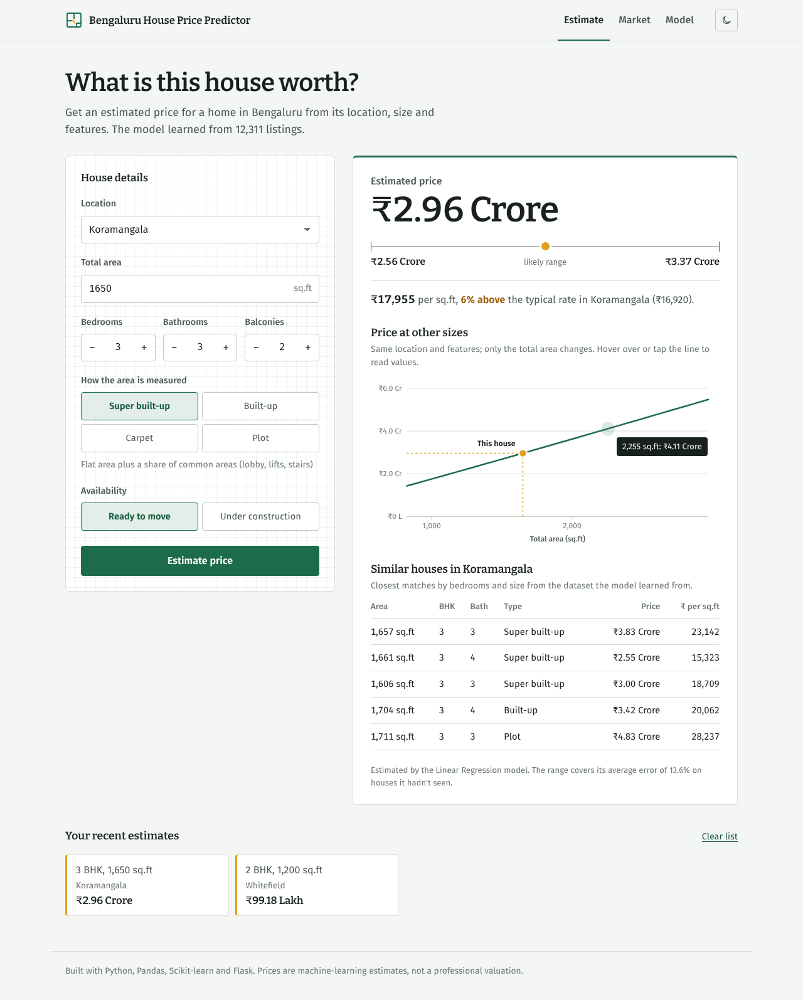
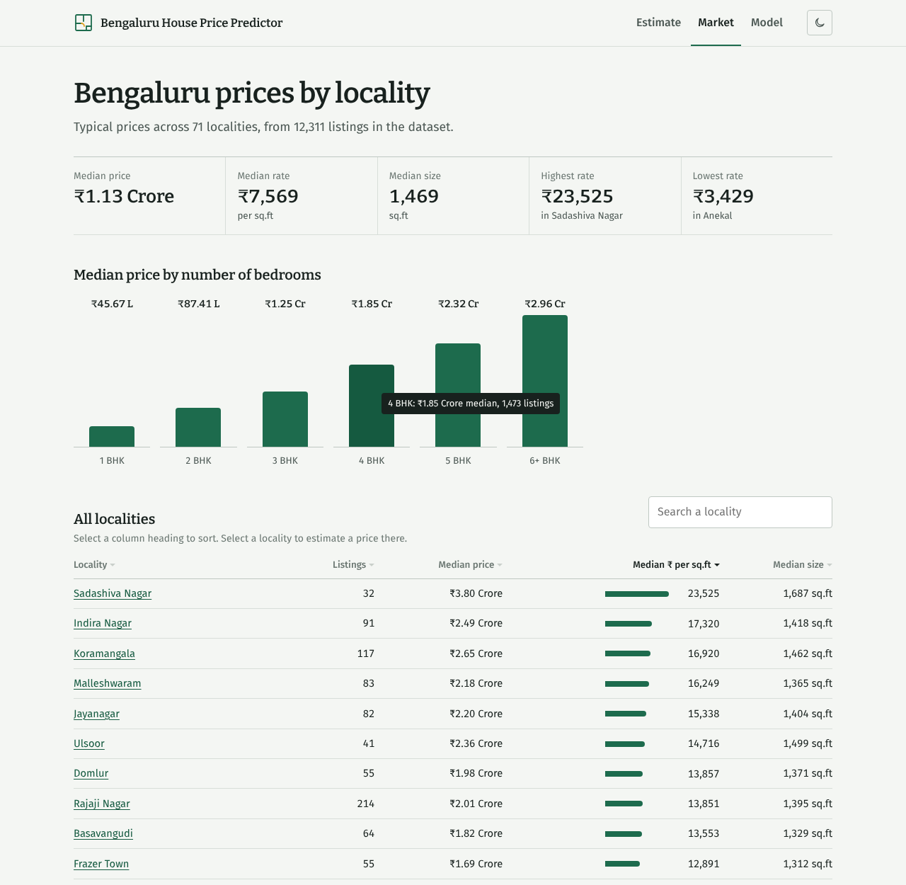
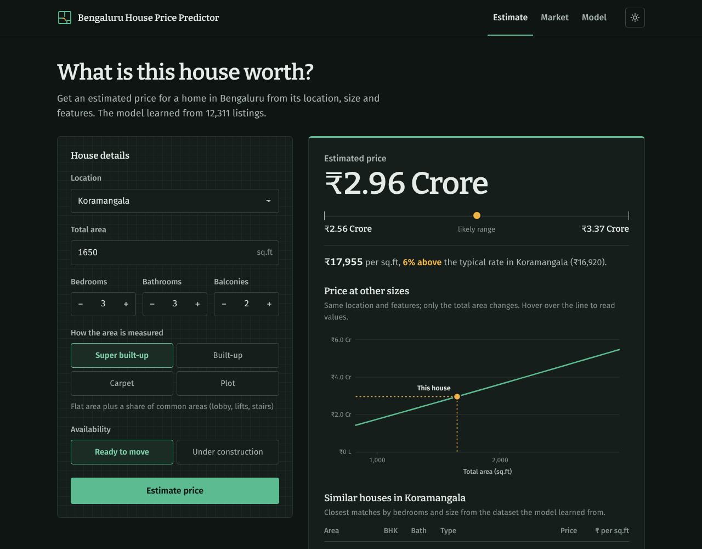

# 🏠 Bengaluru House Price Predictor

[](https://github.com/manvith-546/house-price-prediction/actions/workflows/ci.yml)


A machine-learning web app that estimates the price of a house in Bengaluru from its
**location, area, bedrooms, bathrooms and other features**. It is built with
Python, Pandas and Scikit-learn and has a Flask website.



---

## Contents
- [Features](#features)
- [Quick start in VS Code](#quick-start-in-vs-code)
- [Project structure](#project-structure)
- [How it works](#how-it-works)
- [Results](#results)
- [More screenshots](#more-screenshots)
- [JSON API](#json-api)
- [Use the real Kaggle dataset](#use-the-real-kaggle-dataset)
- [Tests and CI](#tests-and-ci)
- [Run with Docker (optional)](#run-with-docker-optional)
- [Troubleshooting](#troubleshooting)
- [Ideas for improvement](#ideas-for-improvement)
- [License and credits](#license-and-credits)

---

## Features

**Machine learning**
- Cleans messy real-estate data: `"2 BHK"` → 2, `"1100 - 1300"` sq.ft → 1,200, Sq. Yards / Sq. Meter / Acres converted, duplicates and outliers removed
- Compares **6 regression models** (Linear, Ridge, Lasso, Decision Tree, Random Forest, Gradient Boosting) with 5-fold cross-validation
- Tunes the best model with `GridSearchCV` and tests it on houses it has never seen
- One scikit-learn `Pipeline`: imputing, log-transform, scaling, one-hot encoding and the model are saved together
- 9 charts from training: price distribution, correlations, model comparison, actual vs predicted, feature importance and more

**Web app**
- **Estimate page:** price, likely range, price per sq.ft compared with the locality, a price-vs-size chart, similar houses from the data, and your recent estimates
- **Market page:** median prices by number of bedrooms and a searchable, sortable table of every locality
- **Model page:** accuracy, model comparison, what drives the price, training charts and API guide
- Light and dark theme, works on phones, fonts bundled (no internet needed)
- Shareable links, e.g. `/?location=Whitefield&total_sqft=1200&bhk=2&bath=2`
- JSON API for other apps

**Developer experience**
- Ready for VS Code: one-click run configurations, tasks, test explorer and recommended extensions
- `python app.py` trains the model automatically the first time
- 19 automatic tests and a GitHub Actions workflow that trains and tests on every push
- Jupyter notebook that walks through every step (useful for a demo or viva)

---

## Quick start in VS Code

**You need:** [Python 3.11 or newer](https://www.python.org/downloads/) (tick **"Add Python to PATH"** on Windows),
[VS Code](https://code.visualstudio.com/) and [Git](https://git-scm.com/).

### 1. Get the code
```bash
git clone https://github.com/manvith-546/house-price-prediction.git
cd house-price-prediction
code .
```
(Or download the ZIP from GitHub, unzip it, and use **File → Open Folder** in VS Code.)

When VS Code asks, install the **recommended extensions** (Python, Jupyter).

### 2. Create a virtual environment and install packages
Open a terminal in VS Code (**Terminal → New Terminal**):

<table>
<tr><th>Windows</th><th>Mac / Linux</th></tr>
<tr><td>

```bat
python -m venv venv
venv\Scripts\activate
pip install -r requirements.txt
```
</td><td>

```bash
python3 -m venv venv
source venv/bin/activate
pip install -r requirements.txt
```
</td></tr>
</table>

Then press **Ctrl+Shift+P → "Python: Select Interpreter"** and pick the one in `venv`.

### 3. Run it
```bash
python app.py
```
Open **http://127.0.0.1:5000**. The first start trains the model (about a minute) if it isn't trained yet.

### Other ways to run
| What | How |
|---|---|
| Run from VS Code | **Run and Debug** panel (Ctrl+Shift+D) → *Run web app* → ▶ |
| Live reload while editing | *Run web app (auto-reload)* configuration |
| Tasks | **Ctrl+Shift+P → Tasks: Run Task** → Setup / Train model / Run web app / Run tests |
| Tests in the sidebar | **Testing** panel (flask icon) → ▶ |
| One step, Windows | double-click `run_project.bat` |
| One step, Mac/Linux | `./run_project.sh` |

### Command line
```bash
python src/train.py                       # clean data, compare models, save the best one + charts
python src/predict.py --location "Whitefield" --sqft 1200 --bhk 2 --bath 2
python src/predict.py --location "Indira Nagar" --sqft 1800 --bhk 3 --bath 3 \
                      --balcony 2 --area-type "Built-up Area" --under-construction
python src/predict.py --list-locations
python -m unittest discover tests -v      # run the tests
python data/generate_dataset.py           # re-create the sample dataset
```

---

## Project structure

```
house-price-prediction/
├── app.py                        # Flask web app + JSON API
├── House_Price_Prediction.ipynb  # step-by-step notebook
├── requirements.txt
├── data/
│   ├── Bengaluru_House_Data.csv  # raw data (13,320 rows, Kaggle format)
│   └── generate_dataset.py       # creates the sample dataset
├── src/
│   ├── data_prep.py              # loading, cleaning, feature engineering
│   ├── train.py                  # EDA charts, model comparison, tuning, saving
│   ├── predict.py                # prediction functions + command-line tool
│   ├── market.py                 # locality statistics, similar houses
│   └── charts.py                 # SVG chart for the web page
├── models/
│   ├── house_price_model.joblib  # trained pipeline
│   └── model_info.json           # metrics, features, locations, comparison
├── reports/
│   ├── model_comparison.csv
│   └── figures/                  # 9 training charts (PNG)
├── templates/                    # HTML pages (Jinja)
├── static/                       # CSS, JavaScript, fonts, icon
├── tests/test_project.py         # 19 automatic tests
├── docs/screenshots/
├── .github/workflows/ci.yml      # GitHub Actions: train + test on every push
├── .vscode/                      # run configurations, tasks, settings
├── Dockerfile
├── run_project.bat / run_project.sh
└── LICENSE
```

---

## How it works

### 1. Data
Same 9 columns as the Kaggle **Bengaluru House Price Data**:
`area_type, availability, location, size, society, total_sqft, bath, balcony, price` (price in ₹ lakh).

### 2. Cleaning (`src/data_prep.py`)
1. Remove duplicate rows
2. Drop `society` (about 40% missing)
3. Drop rows without location, size or price
4. `size` → `bhk` (number of bedrooms)
5. `total_sqft` → number: ranges averaged, other units converted
6. `availability` → `ready_to_move` (1 / 0)
7. Localities with fewer than 10 houses → `"other"`
8. Outliers removed: under 300 sq.ft per bedroom, bathrooms > bedrooms + 2,
   and price per sq.ft outside 1.5 × IQR **of its own locality**

### 3. Features and pipeline (`src/train.py`)
| Feature | Processing |
|---|---|
| `total_sqft` | median impute → **log** → standard scale |
| `bhk`, `bath`, `balcony`, `ready_to_move` | median impute → standard scale |
| `location`, `area_type` | most-frequent impute → one-hot encode |
| target `price` | model learns **log(price)**, converted back automatically |

Prices are right-skewed and grow in proportion to area, so working on a log scale turns
the relationship into a straight line.

### 4. Model selection
80% of houses are used for training and 20% are kept aside. Each model is scored with
5-fold cross-validation on the training data, the best one is tuned with `GridSearchCV`
(if it has settings to tune), and the final score comes from the untouched test set.

---

## Results

On the included dataset: 9,848 training houses, 2,463 test houses.

| Model | CV R² | Test R² | MAE (₹ lakh) | RMSE (₹ lakh) | MAPE |
|---|---|---|---|---|---|
| **Linear Regression** ✅ | **0.904** | **0.909** | **18.94** | **29.19** | **13.6%** |
| Ridge Regression | 0.902 | 0.907 | 19.02 | 29.48 | 13.6% |
| Gradient Boosting | 0.891 | 0.887 | 20.30 | 32.47 | 14.2% |
| Lasso Regression | 0.884 | 0.889 | 20.08 | 32.15 | 14.1% |
| Random Forest | 0.739 | 0.751 | 26.43 | 48.23 | 17.8% |
| Decision Tree | 0.605 | 0.617 | 34.68 | 59.82 | 24.5% |

- **R²** – share of price differences the model explains (1.0 = perfect)
- **MAE / RMSE** – average error in ₹ lakh (RMSE punishes big misses more)
- **MAPE** – average error in percent; the web app uses it for the "likely range"

**Why linear regression wins:** on a log scale, *price ≈ area × locality rate × small
adjustments*, which is a straight line. Tree models need many splits to learn 70+ locality
effects from one-hot columns. **Most important features:** total area, then location, then
area type.

---

## More screenshots

| Market | Model |
|---|---|
|  |  |

| Dark theme | Phone |
|---|---|
|  |  |

---

## JSON API

```bash
curl -X POST http://127.0.0.1:5000/api/predict \
     -H "Content-Type: application/json" \
     -d '{"location": "Whitefield", "total_sqft": 1200, "bhk": 2, "bath": 2, "balcony": 1, "area_type": "Super built-up Area", "ready_to_move": true}'
```
```json
{"price_lakh": 99.18, "price_text": "₹99.18 Lakh", "range_text": "₹85.67 Lakh - ₹1.13 Crore", "price_per_sqft": 8265, "...": "..."}
```

| Endpoint | Returns |
|---|---|
| `POST /api/predict` | Estimate, likely range, price per sq.ft (only `location`, `total_sqft`, `bhk`, `bath` are required) |
| `GET /api/locations` | Listings, median price, rate and size for every locality |
| `GET /api/info` | Model name, metrics, features, accepted locations and area types |
| `GET /api/health` | `{"status": "ok"}` when the model is loaded |

---

## Use the real Kaggle dataset

The included `data/Bengaluru_House_Data.csv` is a **synthetic sample** made by
`data/generate_dataset.py`. It has the same columns and the same kinds of messy values as
the real file, so the project runs offline. To use real listings:

1. Download **Bengaluru House Price Data** from Kaggle:
   https://www.kaggle.com/datasets/amitabhajoy/bengaluru-house-price-data
2. Replace `data/Bengaluru_House_Data.csv` with the downloaded file.
3. Run `python src/train.py`.

No code changes are needed. Expect lower scores on real data, which is noisier.

---

## Tests and CI

```bash
python -m unittest discover tests -v
```
The 19 tests cover data cleaning, predictions (bigger and better-located houses must cost
more), market statistics, the chart, every page and the API.

On GitHub, `.github/workflows/ci.yml` installs the packages, trains the model and runs the
tests on Python 3.11, 3.12 and 3.13 for every push and pull request. The badge at the top
shows the result.

---

## Run with Docker (optional)

```bash
docker build -t house-price-predictor .
docker run -p 5000:5000 house-price-predictor
```

Settings can be changed with environment variables: `HOST`, `PORT`, `FLASK_DEBUG=1`, `SECRET_KEY`.

---

## Troubleshooting

| Problem | Fix |
|---|---|
| `'python' is not recognized` | Reinstall Python and tick **Add Python to PATH**, or use `py` instead of `python` |
| `venv\Scripts\activate` is blocked in PowerShell | Run `Set-ExecutionPolicy -Scope CurrentUser RemoteSigned` once, or use Command Prompt |
| `ModuleNotFoundError` | Activate the venv and run `pip install -r requirements.txt`; select the venv interpreter in VS Code |
| "The saved model could not be loaded" | Your scikit-learn version differs; run `python src/train.py` (or just `python app.py`) |
| Port 5000 is already in use | `set PORT=5050` (Windows) or `PORT=5050 python app.py` (Mac/Linux) |
| Charts don't open a window | That's expected; they are saved in `reports/figures/` |

---

## Ideas for improvement
- More features: floor, building age, furnishing, parking, distance to metro and IT parks
- Try XGBoost / LightGBM or target encoding for locations
- A map of predicted prices by locality
- Deploy online (Render, Railway or PythonAnywhere)

---

## License and credits
- Code: [MIT License](LICENSE)
- Dataset format: [Bengaluru House Price Data](https://www.kaggle.com/datasets/amitabhajoy/bengaluru-house-price-data) on Kaggle
- Fonts: [Fira Sans](https://fonts.google.com/specimen/Fira+Sans) and [Bitter](https://fonts.google.com/specimen/Bitter), SIL Open Font License (`static/fonts/`)
